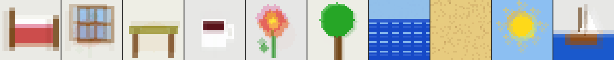
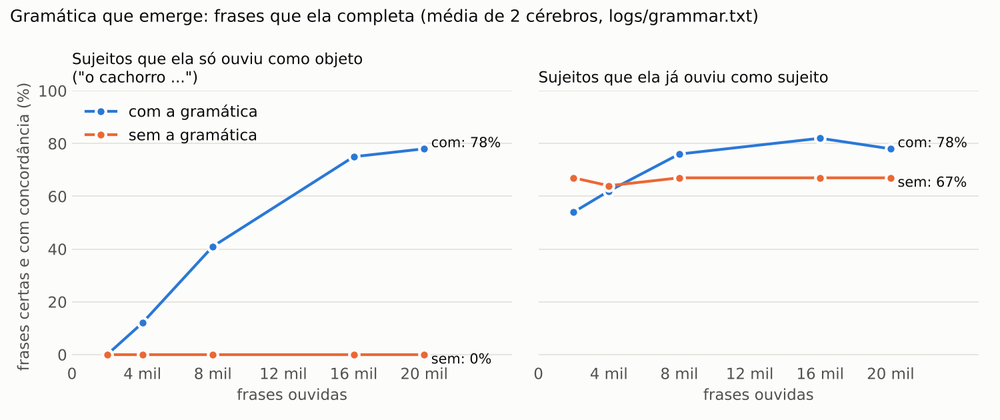

# Eva

Um cérebro simulado em C++, inspirado na biologia, feito para conversar de verdade: sem modelo de linguagem, sem moldes de texto. Tudo que ela diz emerge do que ela viveu e do que está sentindo.

Há duas Evas neste repositório:

- **Eva 2** (`v2/`, executável `eva2`): um **córtex de colunas** (memória temporal hebbiana, no modelo de Hawkins/Numenta) ligado a um **mundo** onde ela percebe e age, com **olhos** (um córtex visual hebbiano que vê, lembra e imagina imagens) e **gramática que emerge** (ela descobre sozinha as espécies de palavras ouvindo 20 mil frases de uma casa, e diz frases certas que nunca ouviu), um **tema** (ela responde sobre o assunto da sua frase), **memória de episódios** e **papéis** (entende quem fez o quê pela ordem das palavras, responde "cadê / o que / quem" pelo que lembra, e fala sozinha do que viu), **quantidade e tempo** (vê se é um ou muitos e diz "os gatos"; responde "o que o gato comeu?" no passado), e, experimental, **cenas vistas pelos olhos** em vez de símbolos. Frases longas, contexto longo, memória que persiste em disco entre conversas, e **sentido**: palavras ancoradas no que ela vê, faz e sente. É a que conversa.
- **Eva 1** (`src/`, executável `eva`): neurônios de pulsos ms a ms, hipocampo, sono, dopamina. É onde tudo começou, e onde ficaram os experimentos e as medições que levaram à Eva 2. Está documentada mais abaixo.

## Eva 2 em uma página

**Como ela funciona.** Cada palavra é um código esparso: 40 colunas ativas em 2048. Cada coluna tem 16 células, e **qual célula dispara depende do que veio antes**: "musica" depois de "gosto de" usa células diferentes de "musica" depois de "ouve". É o código conjuntivo que a Eva 1 não conseguiu formar no hipocampo, agora no lugar certo. Cada célula aprende, por sinapses hebbianas em segmentos dendríticos, a prever quem vem a seguir. Quando a previsão acerta, só as células previstas disparam (o contexto se preserva); quando erra, a coluna inteira "explode" e uma célula aprende o contexto novo. Aprendizado local, uma exposição já cria a sinapse (como o hipocampo), e a dopamina escala a força do aprendizado: o que foi dito com carinho fica mais firme.

**A conversa é um fluxo só.** Tudo entra na mesma sequência: `<voce> [estados] suas palavras <fim> <eva> [estados] palavras dela <fim> ...`. Os estados internos (`<feliz>`, `<curiosa>`, `<surpresa>`) entram no fluxo como palavras, então o que ela ouve e diz fica ligado ao que sentia na hora. Antes de ouvir você, o córtex relê os últimos 6 turnos: é o contexto longo.

**Como ela decide o que dizer.** Abre o turno dela (`<eva>` + estados) e deixa o córtex prever a próxima palavra, e a próxima, até `<fim>`. Se o contexto exato não prevê nada, a coluna explode e segue pela continuação mais comum (é como a gente conclui uma frase: pelo caminho mais batido). Se a frase que você disse era nova, ela **imita** primeiro (novidade → ecolalia, como uma criança). Se ia repetir o que acabou de dizer, procura outro caminho (habituação). Se nada vem, pega o gancho na sua última palavra (associação livre). Se ainda assim nada vem, fica em silêncio.

**Surpresa de verdade.** A surpresa dela é o erro de previsão do córtex: a fração de colunas que não eram previstas. Na primeira vez que você diz uma frase, 1,00; na segunda, 0,20.

**Memória longa.** Ao sair, ela salva o córtex inteiro (`eva2_memoria.bin`) e um diário legível (`eva2_diario.txt`). Na próxima conversa, lembra: `completar eu me chamo` → `pedro`.

**Medido** (`v2/tests/bench.cpp`): 20 frases de 5 a 8 palavras, cheias de palavras compartilhadas ("eu gosto de", "eu vou", "o mar", "hoje"), 8 sementes, completando a partir das 2 primeiras palavras:

| Exposições | Palavras na ordem certa | Frases inteiras |
|---|---|---|
| 1 | 57% | 64/160 |
| 2 | **73%** | **112/160** |
| 3 | 77% | 122/160 |

(Hoje, com o córtex escalável e a punição de previsão errada corrigida, 2 exposições dão **81%** e 121/160 (83% e 123/160 antes da competição entre intenções, na seção "Falar sobre o assunto"); veja "Gramática que emerge".) Boa parte dos erros restantes é ambiguidade legítima do começo ("eu vou" → trabalhar? dormir? viajar?). Roda em 1 segundo. Para comparar: a Eva 1 chegava a 80% em 3 frases curtas *sem* palavra compartilhada, e caía a 55% com uma só palavra compartilhada.

**Conversa real, sem edição** (primeira sessão, do zero):

```
Voce: oi eva tudo bem
         Eva: oi eva tudo bem   [eco <surpresa>]
Voce: eu me chamo pedro
         Eva: eu me chamo pedro   [eco <surpresa>]
Voce: eu gosto muito de musica !
         Eva: eu gosto muito de musica   [eco <feliz> <surpresa>]
Voce: amanha eu vou viajar para o mar
         Eva: amanha eu vou trabalhar cedo   [eco <feliz> <surpresa>]   <- caminho mais batido; aprende "viajar" na 2a vez
Voce: o mar e bonito !
         Eva: o mar e bonito   [eco <feliz> <surpresa>]
Voce: eu gosto muito de voce !
         Eva: amanha eu gosto muito de voce   [resposta <feliz>]
```

Segunda sessão, dias depois (ela carregou a memória):

```
(Eva lembra: 18 turnos, 33 palavras, 2541 segmentos)
Voce: completar eu me chamo
         Eva: eu me chamo ... pedro
Voce: completar o mar
         Eva: o mar ... e bonito
Voce: eu gosto de rock !
         Eva: eu gosto muito de rock   [eco <feliz> <surpresa>]   <- misturou com "eu gosto muito de musica"
```

## Sentido: o mundo dela

Sentido não vem de palavras ligadas a palavras. Vem de palavras ligadas ao que se percebe e ao que se faz. Então a Eva 2 ganhou um **mundo** (`v2/world.hpp`): quarto, cozinha, jardim e praia, com coisas em cada lugar (algumas mudam de lugar), hora do dia, fome e cansaço. Ela percebe (`[esta:praia] [ve:mar] [sente:fome]`) e age (`{ir:jardim} {pegar:pao} {comer} {dormir}`). Percepções e ações entram no **mesmo fluxo** do córtex que as palavras.

Três camadas fazem o sentido:

1. **Córtex associativo** (`v2/semantics.hpp`): co-ocorrência hebbiana entre percepções e palavras, em qualquer ordem, escalada pela dopamina, pontuada por especificidade (uma palavra que aparece com tudo não significa nada em especial). Nas duas direções: ver → nomear, ouvir → imaginar.
2. **Atenção conjunta:** você aponta (`/aponta flor`) e a próxima frase sua cola no que ela está olhando. É assim que bebês aprendem palavras (Tomasello), e aqui faz a diferença entre aprender e não aprender: **sem apontar, 30% dos nomes certos; apontando, 100%** (`v2/tests/ground.cpp`, 10 objetos, 8 sementes, uma volta pela casa). Sem apontar ela confunde o que vê junto ("vê janela → cama"), que é exatamente o problema de referência das crianças.
3. **Corpo e recompensa:** fome e cansaço crescem; comer com fome e dormir cansada dão dopamina, e a dopamina escala o aprendizado percepção → ação (três fatores). Há reflexos inatos (com fome, come o que tem na mão) sobre os quais o aprendizado se constrói, e exploração quando nada é previsto.

**Compreensão.** Ouvir uma palavra evoca percepções. Se "praia" evoca `[esta:praia]` e ela não está lá, isso vira **intenção**: ela caminha, um passo por turno, até chegar. Palavras que aparecem em quase toda frase ("a", "o", "e") não guiam a imaginação, como os bebês também as ignoram no começo.

Trecho real da demonstração (`./build/eva2 --demo`):

```
[Teste de sentido] So a percepcao, sem conversa. O que ela diz vendo cada coisa?
  ve cama     -> cama
  ve janela   -> janela
  ve flor     -> flor
  ve mar      -> mar e boa
  ve cafe     -> cafe
  ve passaro  -> (nada; nao sabe nomear)       <- ninguem nomeou o passaro

[O que as palavras evocam nela]
  'praia' -> [esta:praia](0.15) [ve:areia](0.15) [ve:barco](0.15)
  'flor'  -> [ve:flor](0.46)

[Compreensao] Ela esta no quarto. Voce diz 'vamos para a praia'.
         Eva: vamos para a praia   [eco <feliz> <surpresa>]
         Eva foi para jardim (indo para praia)   [{ir:jardim}]
         Eva foi para praia (indo para praia)    [{ir:praia}]

[Sozinha na praia] 20 s de silencio. O que ela diz, vendo o mar?
         Eva: mar e boa   [pensamento <curiosa>]

[Fome] Voce a leva a cozinha e fica quieto.
         Eva pegou fruta   [{pegar:fruta}]
         Eva comeu fruta   [{comer}, recompensa]
```

Quando ela vê algo que ninguém nomeou e está curiosa, ela **aponta** (`Eva: (aponta para livro)`): a pergunta antes da palavra.

Comandos do mundo no modo conversa: `/leva lugar`, `/aponta objeto`, `/da objeto`, `/ver`, `/nomear objeto` (o que ela diria vendo só aquilo), `/sentido palavra` (o que a palavra evoca nela, com força), `/imaginar palavras...` (a imagem que evocam → `imaginou.ppm`), `/olhar` (o que os olhos veem e como ela lembra cada coisa → `olhar.ppm`).

(Os números do trecho acima são da versão em que as percepções eram símbolos. Com os olhos, veja a seção seguinte.)

## Olhos: ver, lembrar e imaginar

Você perguntou como ela poderia *ver*: quando ouvimos ou lembramos de algo, vem a imagem; e tentamos imaginar até o desconhecido. Agora ela tem olhos (`v2/vision.hpp/.cpp`). As coisas do mundo não chegam mais como o símbolo `[ve:mar]`: chegam como **imagens** (32×32, cor), desenhadas diferentes a cada olhar (posição, tom). Ninguém diz a ela o que é o quê.

**O córtex visual** tem duas camadas, as duas com aprendizado hebbiano competitivo, sem professor e sem retropropagação:

- **V1**: um dicionário de 96 traços de 8×8 (bordas, manchas de cor), aprendido com a regra de Oja a partir dos pedaços das imagens. Cada pedaço da imagem é descrito por 3 traços.
- **V2**: 160 unidades de "objeto". A entrada é a presença de cada traço por quadrante (invariância a posição), descontada da média (adaptação: o que está em toda imagem não informa). 6 unidades ativas por imagem. Coisas parecidas ativam unidades parecidas.
- **Descida**: cada unidade de V2 tem sinapses de volta para os pixels, hebbianas (o que a unidade viu enquanto estava ativa). Ativar um código **gera** uma imagem. Lembrar é gerar; imaginar é gerar a partir de códigos que nunca estiveram juntos.

O código de V2 entra no córtex de sequências como um código esparso (cada unidade fala com um punhado fixo de colunas), e cada unidade ativa é uma percepção `[v12]` para o córtex associativo. Uma palavra ouvida se liga às unidades ativas naquele momento, pesadas pela atenção conjunta (o apontado vale 3×, o resto 0,3×).

- **Nomear** (`name_image`): cosseno entre o código visto e o que cada palavra evoca. Uma palavra de lugar ("cozinha") evoca a mesa, o café e a fruta: espalhada, parece menos com qualquer coisa só do que "café". Vale para imagens que ela nunca viu: é generalização de verdade, não busca de tabela.
- **Imaginar** (`imagine_image`): a palavra evoca unidades; a descida reconstrói pixels. Várias palavras acendem unidades de coisas diferentes: sai a **mistura**.
- **Entender**: "pega a flor" evoca unidades; ela pega a coisa à vista cujo código mais se parece com o que foi evocado.

**Medido** (`v2/tests/ground.cpp`: 10 objetos, 4 lugares, 8 sementes; cada exposição é um desenho diferente; o teste usa desenhos novos):

| voltas pela casa (apontando) | nomeou certo (desenho novo) | imaginou certo¹ | "vamos para a praia" | "pega a flor" |
|---|---|---|---|---|
| 1 | 46% | 85% | 0/8 | 8/8 |
| 2 | 58% | 94% | 0/8 | 6/8 |
| 4 | 74% | 92% | 8/8 | 7/8 |
| 8 | 82% | 99% | 8/8 | 7/8 |
| 4, sem apontar | 18% | 41% | 3/8 | 4/8 |

¹ a imagem gerada pela palavra fica mais perto (erro por pixel) de desenhos novos daquele objeto do que de qualquer outro.

Como bebês: uma exposição não basta, e sem atenção conjunta ela aprende muito pouco. "Vamos para a praia" só funciona depois de ouvir "praia" umas três vezes (evidência mínima para uma palavra guiar o corpo). Ela diz "praia" para o sol com frequência: é a palavra que mais ouviu olhando para ele.

O que ela imagina ouvindo só a palavra, depois de 4 voltas (`imagens/ground_imagina.png`: cama, janela, mesa, café, flor, árvore, mar, areia, sol, barco):



Da demonstração (`imagens/demo_imagina.png`): "mar", "flor", "cama", "pão" e **"flor mar"** juntos, que ela nunca viu — uma flor sobre o mar:


**O que aprendi no caminho (ficou documentado porque custou):**

- **Período crítico de V1 é necessário.** Deixar V1 continuar aprendendo depois de V2 se formar derrubou o reconhecimento de 51/60 para 5/60: os traços mudam debaixo dos protótipos, e V2 fica descrevendo um V1 que não existe mais. A solução foi biológica: V1 amadurece cedo (infância, `prime`) e congela; V2 aprende a vida toda com taxa que decai com o uso.
- **Boosting homeostático atrapalhou.** Forçar todas as unidades a vencer igualmente (como no HTM) corrompia o par reconhecer/gerar. Semear as unidades com imagens reais resolve o problema das unidades mortas sem isso.
- **Reconstruir por pedaços dá ruído; gerar por população funciona.** Normalizar cada pedaço gerava imagens sem sentido. A descida direta de V2 para pixels, pesada pela ativação⁴ das unidades, dá imagens limpas.
- **Agrupar por energia é dominado pelo fundo.** A presença (traço está/não está) por quadrante, descontada da média, separa os objetos.
- **O sentido se diluía com os olhos.** Com dezenas de traços por momento, contar a frequência de uma palavra uma vez por par percepção-palavra fazia toda ligação cair para ~0,09. A frequência conta uma vez por momento (`bind_event`), e a atenção vale como repetição.

**O desconhecido.** "flor mar" ela imagina porque conhece as partes. Uma palavra que nunca ouviu ("casa") não evoca nada — e é assim mesmo: ninguém imagina uma palavra sem sentido; imagina-se uma *descrição* feita de partes conhecidas. Juntar mais partes ("uma árvore na praia de noite") é o passo seguinte: já funciona para duas coisas, e o mundo pode ganhar mais partes (cores, tamanhos, posições) para que as descrições componham.

**O que isto é e o que não é.** É sentido no único modo em que ele existe: a palavra "mar" nela está ligada a uma percepção que muda o que ela faz, e agora a percepção é uma imagem que ela pode lembrar e recombinar. Não é visão humana: 32×32 pixels, desenhos simples, sem profundidade nem movimento. Mas a arquitetura é a certa, e ela cresce com o mundo: cada objeto, lugar ou sensação a mais é uma coisa a mais que as palavras podem significar.

## Gramática que emerge

Até aqui ela repetia sequências que tinha ouvido. Uma criança de 2 anos faz mais que isso: ouve "o gato é bonito" e "eu vejo a girafa" e diz, sem nunca ter ouvido, "a girafa é bonita". Para isso ela precisa saber que "gato" e "girafa" são da mesma espécie de palavra. Ninguém conta isso a ela. Agora a Eva também descobre sozinha.

**Como funciona** (três peças novas, todas locais e sem professor):

1. **Categorias pelo uso** (`v2/categories.hpp`). Para cada palavra, ela conta os vizinhos imediatos (o que vem antes, o que vem depois), mas só os vizinhos frequentes contam como contexto ("o", "a", "é", "de", começo e fim de frase), pesados pela surpresa (PPMI). E ouve a terminação da palavra ("bonit**a**", "cas**a**": o gênero no português se ouve). Esse perfil passa por uma projeção aleatória esparsa e uma competição de k vencedores, como o cérebro da mosca faz com cheiros (Dasgupta et al., 2017): perfis parecidos dão códigos parecidos. É a ideia dos "frames frequentes" da aquisição de linguagem (Redington, Chater e Finch, 1998; Mintz, 2003), num circuito neural. Uma palavra ganha categoria depois de ouvida 4 vezes; no sono, as categorias se reorganizam e as conversas regravadas passam a usá-las.
2. **Um segundo córtex, uma área acima** (`ctm_` em `v2/eva2.cpp`). O mesmo algoritmo de colunas, mas recebendo o código de categoria em vez da identidade da palavra: ele aprende sequências de *espécies* de palavras ("artigo masculino, substantivo masculino, é, adjetivo masculino"). As duas áreas trabalham ao mesmo tempo (cada uma num núcleo do processador).
3. **Memória primeiro, gramática quando a memória falha.** Na hora de falar: se o córtex de palavras reconhece o contexto, ela diz o que lembra. Se a última palavra chegou de surpresa (contexto novo), o que a memória sugere é só um chute (tudo que já veio depois daquela palavra em qualquer frase), e a gramática decide: dos chutes ficam os que cabem; se nenhum cabe, ou se a gramática apoia outra espécie de palavra com muito mais força, ela escolhe uma palavra da espécie que a gramática prevê.

**Escala de criança.** O teste não usa 20 frases: usa a fala de uma casa. `v2/corpus.hpp` é uma gramática do português falado com criança: **~770 palavras** (o vocabulário de uma criança de 2 a 3 anos), 19 moldes de frase, concordância de gênero e número, restrições de sentido (quem come é bicho ou gente, o que se come é comida), frequência zipfiana como na fala real. Ela ouve **20.000 frases** em 10 "dias" de 2.000, dormindo toda noite. A mesma gramática gera o que ela ouve e verifica o que ela diz; ela nunca vê a gramática.

**O teste de verdade: frases que ela nunca ouviu.** 20% dos bichos e pessoas são **retidos**: ela só os ouve como objeto ("eu vejo o cachorro", "cadê os macacos", "é um elefante"), nunca como sujeito. Depois começamos a frase por eles ("o cachorro ...") e ela continua.

Medido (`logs/grammar.txt`; `eva2_grammar 10 2000 300 2`: 2 cérebros, cada um com seu sorteio de palavras retidas):

| dia (frases ouvidas) | sujeitos retidos, **com** a gramática: frase certa¹ | os mesmos, **sem** a gramática | sujeitos conhecidos, com / sem a gramática | categoria do vizinho mais parecido é a mesma classe² |
|---|---|---|---|---|
| 1 (2.000) | 0% | 0% | 54% / 67% | 83% |
| 2 (4.000) | 12% | 0% | 62% / 64% | 87% |
| 4 (8.000) | 41% | 0% | 76% / 67% | 89% |
| 8 (16.000) | 75% | 0% | 82% / 67% | 92% |
| 10 (20.000) | **78%** | **0%** | **78% / 67%** | **93%** |



¹ a frase inteira casa com algum molde da gramática **e** concorda em gênero e número. Todas as certas com sujeito retido são frases que ela nunca ouviu.
² classe fina: substantivo masculino singular, adjetivo feminino plural, verbo no plural etc. (94% pela classe gramatical só).

"Sem a gramática" é o **mesmo cérebro** com o córtex de categorias desligado só na hora de falar. Sem ela, com sujeito retido, ela não diz nada (100% de silêncio): a memória de palavras só sabe que depois de "cachorro" a frase acaba. Com ela, depois de 20 mil frases (exemplos da primeira semente):

```
o cachorro está no parque          ok  [nunca ouviu]
o macaco está no escorregador      ok  [nunca ouviu]
os macacos dormem                  ok  [nunca ouviu]
os elefantes são valentes          ok  [nunca ouviu]
os peixes estão no quarto          ok  [nunca ouviu]
o boi é magro                      ok  [nunca ouviu]
os bois são bonitos                ok  [nunca ouviu]
```

Os erros que sobram são de criança: emendar uma frase na outra ("os cachorros são tristes estão no parque"), deixar a frase no meio ("o elefante"), e, numa medição anterior, misturar *ser* e *estar* ("os cavalos são no sofá") e errar a concordância ("o cavalo é muito fria").

As categorias que emergiram (vizinhos mais parecidos, do log):

```
gato     -> pato rato apito biscoito prato sapato        (substantivos masculinos; a terminação puxa "apito")
bonito   -> amarelo claro bagunçado lento curto roxo      (adjetivos masculinos)
correm   -> sorriem sobem dormem saem descem comem        (verbos no plural)
brincar  -> arrumar contar cozinhar dançar nadar olhar    (infinitivos)
```

Ela também tem **infância** agora: `./build/eva2 --nova --infancia 20000` faz ela ouvir 20 mil frases da casa (dormindo a cada 2.000) antes de conversar com você; `/ouvir N` dá mais, e `/categoria palavra` mostra de que espécie ela acha que uma palavra é. Com só a gramática, o que ela dizia depois da infância era quase sempre gramatical, mas não era sobre o que você tinha dito ("o gato é bonito" → "o arroz está no chão"): a gramática diz que espécie de palavra cabe, e *qual* palavra era sorteio. A seção seguinte resolve isso em boa parte.

**O que não funcionou (medido, e ficou documentado):**

- **Categorias como colunas a mais no mesmo córtex.** A primeira versão somava as colunas de categoria às de identidade da palavra, num córtex só. As palavras da mesma espécie passaram a compartilhar células e os contextos se misturaram: "eu gosto de..." puxava "aprender" de "eu quero aprender". O teste de frases caiu de 77% para 54%. A solução foi a de cima: uma área separada, mais abstrata.
- **Punição forte de previsão errada apagava lembranças.** O córtex enfraquecia em 0,02 cada sinapse que previa algo que não veio. Com a sinapse nascendo em 0,51 (limiar 0,50), uma única frase diferente desligava o que tinha sido aprendido. Em fala variada isso é fatal: depois de "a" vêm centenas de palavras. Com 0,004, a surpresa média ao ouvir caiu de 0,46 para 0,27, e o teste de frases subiu de 77% para 82% (83% hoje).
- **A gramática vetando a memória segura** (quando as duas estavam seguras e discordavam): piorou as frases decoradas (82% → 71%) e os sujeitos conhecidos (68% → 60% no dia 4). Desligado.
- **"Contexto novo depois de surpresa" no córtex de categorias** (não reaproveitar a célula que já casava quando a coluna explode, para não fundir contextos): na versão da época, igual no dia 4 (44%) e muito pior no dia 10 (25% contra 56%). Desligado; o log está em `logs/grammar_fresh_context.txt`.

**Escala e velocidade.** Para ouvir 20 mil frases, o córtex precisou mudar por dentro (`v2/temporal_memory.cpp`): antes, cada passo percorria todos os segmentos (13 frases por segundo, caindo); agora cada célula sabe onde estão as sinapses que saem dela, e um passo só toca o que sai das células ativas. Cada sinapse ocupa 4 bytes (24 bits de célula + 8 de permanência, com arredondamento estocástico para que passos menores que 1/255 ainda contem) e mais 4 no índice. Aqui (2 núcleos), ela ouve ~30 frases por segundo; depois de 20 mil frases tem **16 milhões de sinapses** (11 no córtex de palavras, 5 no de categorias) e ocupa 225 MB. `--grande` usa um córtex de 16.384 colunas × 32 células (e 4.096 × 32 de categorias), pensado para uma máquina com 16 GB: a 8 bytes por sinapse com o índice, ~1 bilhão de sinapses cabem. A versão para GPU (CUDA) ainda não existe: vale portar quando a arquitetura parar de mudar.

**O que isto é e o que não é.** É gramática no sentido em que uma criança de 2 anos tem gramática: espécies de palavras descobertas pelo uso, sequências de espécies, e substituição produtiva com concordância, aprendidas só ouvindo. Não é sintaxe adulta: o corpus tem frases de 2 a 6 palavras, sem orações subordinadas, perguntas ou tempo verbal, e a escolha da palavra dentro da espécie ainda é quase aleatória (por isso "o porco come as canecas"). O passo seguinte foi a palavra ser escolhida pelo que ela quer dizer, não só pelo que cabe:

## Falar sobre o assunto

Uma conversa é sobre alguma coisa. Agora a Eva tem um **tema**: uma atividade que decai sobre as palavras, alimentada pelo que você disse (com força 1), pelo que ela está vendo (0,4; o que você aponta, 1) e, de leve, pelo que ela mesma disse. Palavras que aparecem em quase toda frase ("o", "é", "de") não viram tema, como um bebê também as ignora. A cada frase sua, o tema antigo cai pela metade.

**Como o tema muda o que ela diz** (`predict_next` em `v2/eva2.cpp`):

1. **Intenção.** Antes de consultar a memória, ela olha para as palavras do tema que ainda não disse. Se a gramática (o córtex de categorias) diz que aquela espécie de palavra cabe *aqui*, e a apoia com força, a palavra entra. Querer falar do porco vence a lembrança de "os doces".
2. **O caminho até a palavra.** Para dizer "porcos", primeiro é preciso dizer "os", não "o". Ela aprendeu, ouvindo, quem costuma vir logo antes de quem; querer dizer uma palavra pré-ativa o caminho mais forte até ela. É a intenção chegando um passo antes da palavra.
3. **Uma vez dito o assunto, o resto segue** a memória e a gramática (senão ela só repetiria você), e o tema continua pesando a escolha entre lembranças quase iguais.

Duas coisas precisaram mudar para isso funcionar, e as duas são de arquitetura. A primeira: a área de categorias agora só recebe **língua** (palavras, começo e fim de fala; não estados como `<feliz>`, nem percepções), e recomeça a cada turno, porque sintaxe vive dentro da frase. (Isso melhorou também a gramática medida acima: com sujeitos retidos, de 56% para **78%** depois de 20 mil frases. A explicação provável, não isolada: o sono regrava duas falas seguidas, e antes a área de categorias as emendava numa frase só.) A segunda: o começo da fala dela e o da sua são, para essa área, a mesma coisa ("começo de frase"): assim a gramática que ela aprendeu ouvindo vale quando ela fala. Sem isso, o começo de cada resposta era decidido pelo hábito ("os ..."), e o hábito calava o assunto.

**Medido** (`logs/topic.txt`; `eva2_topic 10000 300`): infância de 10 mil frases, depois 300 frases suas, novas para ela, uma de cada vez; ela responde. O mesmo cérebro, carregado do mesmo arquivo, responde com o tema ligado e desligado. Imitação desligada, para medir o que ela produz e não o que repete:

| | no assunto (usa um substantivo da sua frase) | gramatical | no assunto **e** gramatical | eco |
|---|---|---|---|---|
| tema **ligado** | **84%** | **66%** | **56%** | 12% |
| tema desligado | 11% | 57% | 3% | 17% |

(Com a imitação de frases novas ligada, como na conversa normal: 83% / 71% / 57% contra 10% / 48% / 2%; `logs/topic_com_imitacao.txt`.) "Eco" é quando ela não acha o que dizer e repete o começo da sua frase.

**Remedido depois das cenas, e corrigido.** Quando esta seção foi escrita, o resultado era 62% / 72% / **46%**. Medindo de novo depois do passo das cenas (o corpus cresceu: passado, perguntas, cenas), tinha caído para 62% / 60% / **35%** (o mesmo no commit anterior, então a queda veio do passo das cenas, não deste). O log mostrou o porquê: ela respondia muito sobre a frase *anterior* ("os professores sobem" → "a batata é lindo"). O assunto antigo esmaece pela metade a cada frase, e metade ainda passava do limiar de "querer dizer"; as intenções somavam em vez de competir. Agora elas competem: o peso de cada intenção é o tema elevado a 6 (`topic_sharp`), então o assunto de agora (1,0) vence o de antes (0,5) por 64 a 1, mas o de antes ainda aparece quando o de agora não cabe. Medido com 1, 3 e 6: 35%, 52%, **56%**. O custo foi pequeno nas frases decoradas (83% → 81% das palavras).

Respostas reais do log (tema ligado):

```
Voce: o homem come o presunto             Eva: o presunto é perfumado             no assunto, gramatical
Voce: os moços riem                       Eva: os moços gostam da mamãe           no assunto, gramatical
Voce: as raposas comem os chocolates      Eva: os chocolates são muito fortes     no assunto, gramatical
Voce: o avião elegante está na garagem    Eva: o avião está na escola             no assunto, gramatical
Voce: os ratos querem voltar              Eva: vamos voltar                       (pegou o verbo, não o bicho)
Voce: a vovó come a batata                Eva: a batata é lindo                   erro de concordância
Voce: os professores sobem                Eva: a batata é lindo está no sofá      outro assunto (a batata era de antes) e emendou
Voce: os jacarés veem os pavões           Eva: os pavões comem as goiabas são assustadas   emendou frases
```

E uma conversa depois da infância de 20 mil frases (de quando esta seção foi escrita; o `logs/infancia_conversa.txt` de agora é a conversa com cenas, mais abaixo):

```
Voce: o gato é bonito                     Eva: o gato é bonito
Voce: a vaca come a banana                Eva: a banana é brava
Voce: os cachorros correm na praia        Eva: é uma banana                       <- o assunto anterior ainda pesou
Voce: o bebê está na cozinha              Eva: o iogurte está no parque           <- a forma da sua frase, outro assunto
Voce: as meninas querem brincar           Eva: as meninas querem brincar
Voce: o leão é grande                     Eva: é um leão
```

`/tema` mostra do que ela acha que se está falando (`assunto agora: banana(1.10) come(1.00) vaca(1.00) ...`).

**O que isto é e o que não é.** É o começo de "falar sobre": ela pega o assunto da sua frase e diz algo dela sobre ele, com a gramática que aprendeu, em mais da metade das vezes, contra 3% sem o tema. Não é ainda **responder**: ela não entende pergunta ("cadê o gato?" não é diferente de "o gato"), não sabe quem faz o quê na sua frase, e às vezes fala do assunto anterior ou emenda frases. O que ela diz sobre o assunto ainda é o que *cabe* (gramática + lembrança), não o que é *verdade* no mundo dela. Os próximos passos eram esses: quem faz o quê, perguntas e respostas, e memória de episódios. Estão na seção seguinte.

## Quem faz o quê, perguntas e lembranças

Até aqui a Eva falava *sobre* coisas, mas não sabia o que tinha acontecido, nem quem tinha feito o quê, nem o que uma pergunta pede. Agora a infância dela tem **cenas**: coisas que acontecem na casa e que ela vê (o gato comendo o peixe na cozinha), enquanto alguém descreve ("o gato come o peixe"). Às vezes alguém pergunta sobre a cena e responde por ela, como os pais fazem ("cadê o gato? ... o gato está na sala!"). O resto é fala comum da casa.

Três peças novas (`v2/episodes.hpp`, e o resto em `v2/eva2.cpp`):

1. **Memória de episódios** (o hipocampo, aqui abstrato): cada cena vivida vira um episódio: quem, o quê, com o quê, onde, e o quanto importou. Uma pista parcial ("o gato", "come") traz de volta o episódio mais recente que combina. Na Eva 1 o hipocampo era de pulsos; aqui é um índice de episódios, porque o que importa agora é o que ela faz com a lembrança.
2. **Papéis pela ordem das palavras.** Ela *vê* quem age e quem sofre a ação e *ouve* a frase. Contando em que posição da frase (entre as palavras que têm sentido para ela) aparece cada papel, cena após cena, ela aprende a ordem do português: quem faz vem primeiro, depois a ação, depois o alvo ou o lugar. Ninguém ensina a regra. Bebês de 2 anos já fazem isso (Hirsh-Pasek e Golinkoff, olhar preferencial).
3. **O que cada palavra de pergunta pede.** Quando alguém pergunta e responde, ela liga cada palavra da pergunta sem sentido próprio ao que a resposta trouxe de novo: "cadê" passou a pedir um lugar, "que" um alvo, "quem" quem fez, 100% das vezes, sem regra escrita.

E duas que juntam tudo:

- **Plano de fala ordenado.** O tema da seção anterior era um saco de palavras. Para descrever uma cena ou responder, ela agora monta um *plano*: os sentidos que quer dizer, na ordem que aprendeu (quem faz, ação, alvo). Cada item entra quando a gramática deixa; antes dele, o caminho até ele ("a" antes de "gelatina", "está no" antes de "zoológico"); quando o plano acaba, ela termina a frase.
- **Mapeamento rápido.** Uma única exposição basta para um nome novo: numa cena com o gato (já conhecido) e algo novo, a palavra nova se liga à coisa nova, porque a força da ligação é normalizada pelo quanto cada coisa já tem nome. É a "exclusividade mútua" das crianças, de graça.

**Medido** nesta versão (`eva2_scenes 10000 200`: infância de 10 mil momentos, 6.735 cenas; o `logs/scenes.txt` de agora é da versão com número e tempo, na seção seguinte):

| teste | com o que ela aprendeu | sem (no mesmo cérebro) |
|---|---|---|
| **compreensão**: "o boi vê o leão": das duas cenas (o boi vendo o leão, o leão vendo o boi), qual é? pares que ela nunca viu juntos | **100%** | 48% (papéis sorteados; acaso = 50%) |
| **descrição** de cenas novas: frase gramatical com cada papel no lugar certo | **77%** | 26% (ordem sorteada) |
| **perguntas** sobre a cena de 3 cenas atrás ("cadê o gato?", "o que o gato come?", "quem come o peixe?"): gramatical e com o fato certo | **94%** (onde 98%, o quê 93%, quem 74%) | 4% (sem memória: sabe o que se pede, chuta o conteúdo) |
| **pensando alto** em silêncio: o que ela diz é verdade (aconteceu e ela viu)? | **83%** (94% gramaticais) | — |

Do log:

```
pergunta: "cadê o macaco?"         -> "o macaco está no zoológico"   (verdade: zoológico)
pergunta: "quem come a uva?"       -> "o urso come a uva"             (verdade: urso)
pergunta: "o que o gato vê?"       -> "o gato vê o morango"           (verdade: morango)
pergunta: "quem vê o macaco?"      -> (silêncio)                      (verdade: amiga; não achou a lembrança)
descrição: [coruja come pizza]     -> "a coruja come a pizza"
descrição: [macaco vê pudim]       -> "o macaco vê o galo pudim"      <- errada
pensando alto: "os jacarés comem o sanduíche"   [verdade: ela viu isso]
pensando alto: "a barata gosta da abelha"       [verdade: ela viu isso]
```

E uma conversa de verdade depois de uma infância de 10 mil momentos (desta versão; a conversa de agora, com passado e número, está na seção seguinte). As três primeiras linhas são cenas que acontecem na frente dela (`/cena`):

```
(ela vê: mulher gosta irmã, em piscina; você diz: "as mulheres gostam das irmãs")
(ela vê: jacaré está, em praia;         você diz: "o jacaré está na praia")
(ela vê: zebra come doce, em sala;      você diz: "a zebra come o doce")
/conta                  Eva: as zebras comem os doces
Voce: cadê o jacaré     Eva: o jacaré está na praia
Voce: o que a zebra come    Eva: as zebras comem os doces
Voce: quem come o doce      Eva: as zebras comem os doces
Voce: cadê a zebra          Eva: as zebras estão na sala
Voce: cadê as mulheres      Eva: as mulheres estão na piscina
Voce: o gato é bonito       Eva: o gato gosta da borboleta
```

Todas as respostas às perguntas estão certas. Ela ainda erra o número às vezes ("as zebras" para uma zebra só: ela não percebe quantos são, só quem são), e quando pensa alto sem uma lembrança, às vezes diz uma palavra solta ("bonito").

Novos comandos na conversa: `/cena` (algo acontece na frente dela e você descreve), `/conta` (ela descreve a última cena com as palavras dela), e perguntas normais ("cadê o gato", "o que o gato come", "quem come o peixe"), que ela responde pela memória. `--infancia N` agora tem cenas e perguntas além de frases.

**O que deu errado no caminho** (e ficou medido):

- **A "saciedade" impedia o "a" de aparecer duas vezes**: "a girafa come ..." não conseguia dizer "a gelatina", porque palavras já ditas eram evitadas. Agora só palavras de conteúdo não se repetem. A descrição foi de 43% para 44%, e o resto veio das duas correções seguintes.
- **Palavras raras não "cabiam"**: o plano exigia que a gramática previsse 80% do código de categoria da palavra; "pudim" (ouvido 27 vezes) não chegava lá. Com 60% para o que ela *quer* dizer, a descrição foi de 44% para 76% e as respostas de 76% para 91%.
- **O relógio não era salvo**: ao carregar a memória, o tempo voltava a zero e as lembranças "do futuro" pesavam demais; ela repetia a mesma lembrança. Agora o relógio é salvo e contar uma lembrança gasta um pouco dela.

**O que isto é e o que não é.** É compreensão e fala ligadas ao que aconteceu: ela entende quem fez o quê pela ordem das palavras, responde perguntas com o que lembra, e fala sozinha do que viu, quase sempre com verdade. As cenas, porém, chegam como símbolos (quem, o quê, onde), não como imagens; o mundo das cenas tem 5 tipos de acontecimento; e nesta versão ela não percebia quantidade nem tempo. O plano de fala, a recuperação de episódios e a pergunta→papel são arquitetura escrita; o que é aprendido é o sentido das palavras, a ordem dos papéis, o que cada palavra de pergunta pede, e a gramática que preenche o resto. Quantidade, tempo e cenas vistas pelos olhos estão na seção seguinte.

## Quantos, quando, e cenas vistas pelos olhos

Os dois limites da seção anterior que mais apareciam na conversa eram: "as zebras comem os doces" para uma zebra só, e tudo no presente ("o gato come" quando a pergunta era sobre o que já passou). E as cenas chegavam como símbolos. Os três foram atacados.

### Um ou muitos

Agora ela **vê quantos são**: cada cena traz, junto com quem e o quê, uma percepção de número (`[um]` ou `[muitos]`) para quem faz e para o alvo, como o "senso numérico" que bebês já têm para 1 contra vários. A casa fala de acordo ("o gato come o peixe", "os gatos comem os peixes"). Ninguém diz a ela que "-s" é plural.

O que ela faz com isso: um sentido ("gato") tem várias formas que ela ouviu ("gato", "gatos"). A forma que vai para a fala é a que mais se ligou, pela experiência, ao que ela está vendo agora: `[muitos]` puxa "gatos", `[um]` puxa "gato" (`choose_forms`, por diferença de força). O verbo concorda com quem faz pela gramática que ela já tinha ("os gatos" → "comem").

### Agora ou antes

Os verbos agora têm passado no corpus ("comeu/comeram", "viu/viram", "gostou/gostaram", "correu/correram", "estava/estavam", ...). A infância tem dois tipos de momento novos: alguém **conta** uma cena que já passou ("o gato comeu o peixe") e **pergunta no passado** sobre ela ("o que o gato comeu? ... o gato comeu o peixe!"). Durante essas falas ela percebe `[antes]`; nas cenas que acontecem na frente dela, `[agora]`.

- Para **falar** no passado ela usa o mesmo mecanismo do número: entre as formas de "come", a que mais se ligou a `[antes]` é "comeu".
- Para **saber se a pergunta é no passado**, ela olha a palavra da pergunta mais marcada por `[antes]` ou `[agora]` (`sounds_past`). "o que o gato comeu?" → passado; "o que o gato come?" → presente. Ela responde no tempo da pergunta.
- Quando **pensa alto** sozinha, o que ela lembra já passou: ela conta no passado ("a médica estava na rua").

### Medido (`logs/scenes.txt`)

Mesmo teste da seção anterior (`eva2_scenes 10000 200`), agora com número e tempo. Infância de 10 mil momentos, 5.181 cenas:

| teste | com o que ela aprendeu | sem (no mesmo cérebro) |
|---|---|---|
| compreensão: "o boi vê o leão", qual das duas cenas? | **100%** | 48% (acaso 50%) |
| descrição de cenas novas, gramatical e com os papéis no lugar | **74%** (gramatical 84%) | 25% (ordem sorteada) |
| **quantidade**: nas descrições certas, um/muitos certo para quem faz e para o alvo | **98%** | 28% (sem a percepção de número) |
| perguntas sobre a cena de 3 cenas atrás, gramatical e com o fato certo | **94%** (fato certo 98%; onde 100%, quem 93%, o quê 69%) | 6% (sem memória) |
| **tempo**: a resposta vem no tempo da pergunta ("come/comeu") | **91%** | 50% (sem o tempo aprendido) |
| pensando alto: 18 falas | 67% gramaticais, 56% verdadeiras, 67% no passado | — |

Do log:

```
descrição: cena [irmã está em zoológico]  -> "as irmãs estão no zoológico"      [certa: eram várias]
descrição: cena [girafa come gelatina]    -> "as girafas comem as gelatinas"    [certa: várias e várias]
descrição: cena [macaco vê pudim]         -> "o macaco vê o pudim"              [certa: um e um]
pergunta: "o que a gata comeu?"   -> "a gata comeu o pudim"            (verdade: pudim)
pergunta: "quem vê o macaco?"     -> "a amiga vê o macaco"             (verdade: amiga)
pergunta: "o que o urso comeu?"   -> "o urso come a comeu a uva"       <- fato certo, frase errada
pergunta: "quem comeu a uva?"     -> "o galo comeu"                    <- fato certo, faltou o alvo
pergunta: "o que o tigre viu?"    -> "o tigre vê a pata viu os bolos escondidos estão no sofá"   <- errada (verdade: tomate)
pensando alto: "a pata brincou"                  [verdade: ela viu isso]
pensando alto: "os professores viram o ursinho"  [verdade: ela viu isso]
pensando alto: "as irmãs gostaram o martelo"     [fora da gramática]
```

O ponto fraco é o "o quê" no passado: a forma do passado ("comeu", "viu") é rara e às vezes não cabe na gramática naquele ponto; ela começa no presente, e o passado entra depois, emendado. As perguntas "onde" e "quem" quase não erram.

E a conversa (`logs/infancia_conversa.txt`, depois de `--infancia 10000`; as quatro primeiras linhas são cenas na frente dela):

```
(ela vê: médica sobe, em garagem;           você diz: "a médica sobe")
(ela vê: papai come bolacha, em praça;      você diz: "o papai come a bolacha")
(ela vê: gata chega, em cozinha;            você diz: "a gata chega")
(ela vê: palhaço gosta sino, em varanda;    você diz: "os palhaços gostam do sino")
/conta                         Eva: os palhaços gostam o sino
Voce: cadê a médica            Eva: a médica está na garagem
Voce: o que o papai come       Eva: o papai come a bolacha
Voce: o que o papai comeu      Eva: o papai comeu a bolacha
Voce: quem comeu a bolacha     Eva: o papai comeu a bolacha
Voce: cadê os palhaços         Eva: os palhaços estão na varanda
Voce: cadê a gata              Eva: a gata está na cozinha
(30 s de silêncio)             Eva: cadê as tapiocas
                               Eva: os professores estavam na varanda
                               Eva: a barata estava na casa
```

Todas as respostas certas, no número e no tempo certos ("os palhaços", "comeu" quando a pergunta é no passado, "come" quando é no presente). O `/conta` errou a preposição ("gostam o sino"), e ela pensa alto no passado ("estavam", "estava"), porque lembrança é passado.

**O que deu errado no caminho:**

- **As formas do passado não tinham sentido.** "comeu" aparece muito menos que "come", e a força crua da ligação nunca deixava "comeu" ser o nome de `[acao:come]`. O sentido de uma palavra passou a ser medido pela **especificidade** (quanto da experiência da palavra vem daquela percepção), não pela força total. Isso também tirou o "o" do papel de ação (ele tinha virado "nome" de `[acao:come]` por aparecer sempre junto).
- **Perguntas no presente eram respondidas no passado**, porque "que" aparecia mais nas perguntas no passado. Agora conta a palavra da pergunta *mais* marcada pelo tempo, não a soma.
- **"o que o urso comeu" era lida como "quem"**: "comeu" tinha virado palavra de pergunta. Agora só palavras *sem sentido próprio* contam como palavra de pergunta.
- **"o papai vê os elefantes" em vez de "o papai come a bolacha"**: quando o córtex de categorias não tinha opinião firme (nada cabia bem), o verbo do plano ficava de fora. Agora, quando a gramática está insegura, a intenção decide.
- **"o papai vê os palhaços" para "o que o papai comeu?"**: depois de "o papai", a memória de palavras lembrava exatamente "comeu" (é o que ela ouviu), mas a espécie de "comeu", palavra rara, ainda era mal prevista pelo córtex de categorias, e o plano a recusava. Agora, se a memória de palavras lembra com segurança justamente o que ela quer dizer, isso basta.

### Cenas vistas pelos olhos (experimental)

O passo mais difícil: tirar os símbolos. Com `--olhos` (ou `EYES=1` no teste), quem faz, o alvo e o lugar chegam como **imagens**: cada uma das 202 coisas da casa tem um desenho próprio (forma, cores, marcas), desenhado um pouco diferente a cada vez (posição, tom), e cada um dos 24 lugares tem um fundo próprio (listras, xadrez, diagonais). Ninguém diz a ela que aquele desenho é "gato".


Como ela forma um conceito do que vê (`v2/vision.cpp`):

1. **Traços que não ligam para a posição.** As 96 unidades de V1 (detectores de borda e cor, hebbianos) varrem a imagem inteira; para cada uma fica a resposta mais forte (como as células complexas: "tem uma borda vertical vermelha em algum lugar"), no todo e em 3×3 zonas da caixa do objeto. São 960 números, normalizados pela média e desvio de tudo o que ela já viu (modelo HMAX, Riesenhuber e Poggio).
2. **Conceitos por exemplares.** Um conceito guarda até 8 vistas; algo novo cai no conceito com maior semelhança média, ou abre um conceito novo.
3. **A palavra ajuda a ver.** Se ela ouve um nome que já tem um conceito visual forte, o limiar para cair nele é menor (como "olha o gato!" ajuda a criança a juntar vistas diferentes).

O conceito visual vira a percepção da cena (`[ve:c37]` em vez de `[ve:gato]`), e todo o resto (sentido das palavras, papéis, perguntas, memória) é o mesmo de antes.

**Medido** (`logs/scenes_olhos.txt`; `EYES=1 eva2_scenes 10000 200`), honestamente fraco:

| | pelos olhos | com símbolos (acima) |
|---|---|---|
| conceitos formados | 358 de coisas (para 202) e 22 de lugares (para 24) | — |
| a mesma coisa vista 3 vezes cai no mesmo conceito | 68% | 100% |
| coisas com um conceito só delas | 70% | 100% |
| compreensão (qual das duas cenas) | 66% (sem a ordem: 54%) | 100% |
| descrição certa | 10% | 74% |
| perguntas certas | 14% (onde 20%; silêncio 44%) | 94% |
| pensando alto, verdadeiras | 11% | 56% |

Onde está a perda: quase tudo vem do primeiro passo. Com 202 coisas, um terço das vistas cai num conceito errado ou num conceito novo, e uma palavra ligada a dois conceitos (ou um conceito ligado a duas palavras) quebra a cadeia sentido → papel → memória → resposta. Mesmo com os conceitos perfeitos, o melhor que esses traços conseguem é ~80% de acerto ao reconhecer qual das 202 coisas é (vizinho mais próximo pela média de cada coisa, medido à parte): os traços de V1 sozinhos não bastam para tantas coisas parecidas.

O que foi tentado e não funcionou: os códigos de V2 da seção "Olhos" (25% de consistência com tantas coisas); traços de "presença" sem zonas; protótipos por média móvel (desabavam todos num conceito); exemplares por semelhança máxima (encadeavam coisas diferentes); juntar no sono conceitos que têm o mesmo nome (`merge_specificity`; as junções erradas se propagavam e pioraram tudo, ficou desligado). Os desenhos tinham colisões (duas coisas com a mesma aparência); agora cada coisa tem uma combinação única.

Os próximos passos dos olhos são uma hierarquia visual de verdade (V2/V4 aprendidos sobre esses traços, não só V1), olhar mais de uma vez (sacadas: três olhares na mesma coisa), e deixar a palavra corrigir o conceito *depois* (separar um conceito quando a mesma vista recebe dois nomes diferentes com frequência).

Na conversa: `./build/eva2 --olhos --infancia 10000` vive a infância pelos olhos, e `/cena` escreve o que ela viu em `cena.ppm`.

### Próximos passos (Eva 2)

- **Olhos que dão conta de 200 coisas**: a hierarquia visual e as sacadas acima, até as cenas pelos olhos chegarem perto das cenas por símbolos.
- **Frases que não emendam**: a maior parte dos erros que restam é a frase continuar depois do fim ("o tigre vê a pata viu os bolos..."). O fim da frase precisa de um sinal próprio (o plano acabou *e* a gramática fecha), não só da previsão de `<fim>`.
- **Mais de uma frase por vez e diálogo de verdade**: perguntar de volta, dizer "não sei", corrigir o que ouviu errado; hoje ela responde e para.
- **Um mundo de cenas maior**: mais tipos de acontecimento (dar, pegar, ir de um lugar a outro), causas ("porque"), e quem fala com quem.

## Resultados, logs e imagens

- `logs/`: saídas reais de todas as demonstrações e medições (sem edição), com o comando que gerou cada uma.
- `imagens/`: o que ela vê, lembra e imagina.
- `v2/tests/` e `tests/`: os programas de medição, com instruções de compilação.

| o quê | resultado | log |
|---|---|---|
| frases longas (20 frases, 2 exposições, 8 sementes) | 81% das palavras, 121/160 frases inteiras (era 83% e 123/160 antes da competição entre intenções) | `logs/bench2.txt` |
| falar sobre o assunto: responde usando um substantivo da sua frase, e gramatical | 56% com o tema; 3% sem | `logs/topic.txt` |
| quem faz o quê: "o A vê o B", qual das duas cenas? | 100% (acaso 50%) | `logs/scenes.txt` |
| descrever uma cena nova na ordem certa | 74% (25% com a ordem sorteada) | `logs/scenes.txt` |
| responder "cadê / o que / quem" sobre o que viu 3 cenas atrás | 94% com memória; 6% sem | `logs/scenes.txt` |
| quantidade: um/muitos certo na descrição | 98%; 28% sem a percepção de número | `logs/scenes.txt` |
| tempo: responde no tempo da pergunta ("come/comeu") | 91%; 50% sem | `logs/scenes.txt` |
| pensando alto: o que ela diz aconteceu de verdade | 56% (67% gramaticais; 67% no passado) | `logs/scenes.txt` |
| cenas vistas pelos olhos (experimental): compreensão / perguntas certas | 66% / 14% | `logs/scenes_olhos.txt` |
| gramática: começar a frase com um bicho que ela só ouviu como objeto (20 mil frases) | 78% frases certas e novas com a gramática; 0% sem ela | `logs/grammar.txt` |
| gramática: sujeitos conhecidos (20 mil frases) | 78% com a gramática; 67% sem | `logs/grammar.txt` |
| categorias: o vizinho mais parecido é da mesma classe (20 mil frases) | 93% | `logs/grammar.txt`, `logs/categories_test.txt` |
| nomear desenhos novos (4 voltas apontando) | 74% (82% com 8 voltas) | `logs/ground.txt` |
| imaginar pela palavra (4 voltas) | 92% parece mais com a coisa certa (99% com 8) | `logs/ground.txt` |
| entender "vamos para a praia" / "pega a flor" | 8/8 e 8/8 | `logs/ground.txt` |
| só o córtex visual | erro de imaginação 0,08 por pixel; mesma coisa 0,49 / coisas diferentes 0,02 de sobreposição | `logs/vision_test.txt` |

## Compilar e rodar (as duas)

```bash
cmake -S . -B build -DCMAKE_BUILD_TYPE=Release
cmake --build build        # requer PIL (python3 -m pip install pillow) só para converter as imagens PPM em PNG
./build/eva2             # conversar com a Eva 2 (lembra de conversas anteriores)
./build/eva2 --demo      # demonstração automática
./build/eva2 --nova      # começar sem memória
./build/eva2 --nova --infancia 10000   # antes de conversar, ela vive 10 mil momentos da casa: frases, cenas, perguntas (~8 min aqui)
./build/eva2 --grande    # córtex grande (16.384 colunas x 32 células), para máquinas com 16 GB
./build/eva2_grammar 10 2000 300 2     # a medição de gramática (veja v2/tests/README.md para todas)
./build/eva              # Eva 1: demonstração
./build/eva --conversa   # Eva 1: conversar
```

---

# Eva 1 (neurônios de pulsos)

## Como a fala dela nasce (interocepção)

Os estados internos da Eva (dopamina, curiosidade, surpresa) agora são **conceitos no córtex**, `<feliz>`, `<curiosa>` e `<surpresa>`, que disparam sozinhos conforme a química dela. Isso muda tudo: o que ela ouve enquanto está feliz fica ligado a `<feliz>` no hipocampo, e quando ela fica feliz de novo, por outro motivo, `<feliz>` acende e puxa aquilo. Ela diz "eu gosto de musica" porque *está sentindo aquilo*, não porque calculou que era provável. É a palavra ancorada no sentimento.

O estado também escolhe o **tipo** de fala, como em qualquer bicho:

- **novidade → imitar:** ela ecoa o que acabou de ouvir (é assim que a fala começa);
- **estar bem → lembrar:** o humor (dopamina tônica, que dura ~10 s) puxa o que ela viveu estando bem;
- **curiosidade → perguntar:** ela traz à tona a palavra que menos conhece e deixa a rede completar; sai com "?";
- **vontade de falar baixa → silêncio.** Ela não responde a tudo.

Os colchetes na saída mostram o tipo da fala e o estado interno na hora: `Eva: eu gosto de   [resposta <feliz>]`.

Trecho real da demonstração (uma sessão, sem edição):

```
Voce: bom dia eva
         Eva: bom dia eva   [eco <surpresa>]
Voce: eu gosto de musica  (com carinho)
         Eva: eu gosto de musica   [eco <feliz> <surpresa>]
Voce: vou dormir cedo
         Eva: vou dormir   [eco <feliz> <surpresa>]
  [ 41.5s] Eva: vou dormir?   [pergunta <curiosa>]
Voce: oi eva  (com carinho)
         Eva: vou oi gosto de musica bom   [resposta <feliz> <surpresa>]   <- feliz puxa tudo que viveu feliz, misturado
```

A última linha mostra o estágio atual: quando `<feliz>` acende, ele puxa *todas* as frases vividas em bom humor de uma vez, e elas saem misturadas. Ecos de frases únicas já saem inteiros.

## Conversando com a Eva

No modo `--conversa`, você fala com ela em frases curtas (até 6 palavras). Ela aprende palavras novas na hora (até 48) e aprende a **ordem** em que vieram. Depois de cada frase sua, ela pode responder (ou não), e então passam 3 segundos de silêncio em que ela pode puxar assunto.

```
Voce: cafe manha              -> ela vive "café", depois "manhã"
Voce: mar praia !             -> o "!" é carinho: libera dopamina, a memória fica mais forte
Voce: recitar mar             -> dê a primeira palavra; ela completa a frase
Voce: esperar 15              -> 15 s de silêncio; ela pensa sozinha e pode falar
Voce: dormir 30               -> ela dorme e consolida as memórias
Voce: lembrar mar             -> o que "mar" acende na cabeça dela (associação, sem ordem)
Voce: estado                  -> dopamina, impulsos, o que ela sabe de cada palavra
```

Exemplo real:

```
Voce: oi eva
        (surpresa 1.00, dopamina 0.54, nova: oi, nova: eva)
         Eva: oi eva   [eco <surpresa>]
Voce: eu gosto de voce !
Voce: eu gosto de voce !
         Eva: eu de   [eco <feliz> <surpresa>]
Voce: vou trabalhar agora
Voce: voltei !
         Eva: eu   [resposta <feliz> <surpresa>]
Voce: esperar 20
  [ 54.0s] Eva: trabalhar?   [pergunta <curiosa>]
```

## O que a demonstração mostra

1. **Manhã:** você conversa com ela, que não sabe nada. Ela ecoa; "eu gosto de musica" vem com carinho e fica ligada a `<feliz>`.
2. **Tarde:** silêncio. Ela pergunta sobre o que menos conhece.
3. **Fim de tarde:** você volta com carinho; a dopamina sobe, `<feliz>` acende, e o que ela viveu feliz volta.
4. **Noite:** ela dorme; o hipocampo repete as memórias e o córtex aprende.
5. **Manhã seguinte:** o que ela traz do sono.

Isso reproduz fenômenos reais: pacientes com lesão no hipocampo (como o famoso H.M.) perdem memórias recentes, mas mantêm as antigas; memórias com carga emocional são lembradas melhor; o novo libera dopamina; dormir fixa o que se aprendeu; e a mente "vagueia" quando não há nada acontecendo.

## Da biologia para o código

| No cérebro | Na Eva | Arquivo |
|---|---|---|
| Neurônio que integra e dispara | Neurônio LIF (integra-e-dispara com vazamento) | `population.cpp` |
| Cansaço do neurônio | Adaptação: quem disparou muito fica mais difícil de excitar | `population.cpp` |
| Interneurônios inibitórios | Inibição global + "k vencedores" no hipocampo | `population.cpp`, `eva.cpp` |
| Sinapse que aprende com o tempo dos disparos | STDP: pré antes do pós fortalece, depois enfraquece | `projection.cpp` |
| Dopamina como "carimbo" de importância | Aprendizado de 3 fatores: STDP marca, dopamina confirma | `projection.cpp`, `neuromodulators.hpp` |
| Homeostase sináptica | Cada neurônio tem um orçamento total de peso de entrada | `projection.cpp` |
| Acetilcolina (acordada vs. sono) | No sono, as conexões internas do hipocampo ficam mais fortes | `eva.cpp` |
| Ondas lentas e *sharp-wave ripples* | Estados UP a cada 250 ms disparam replays | `eva.cpp` |
| Rede de modo padrão (divagação) | Replays mais raros e fracos acordada; cada um é um "pensamento" | `eva.cpp` (`live`) |
| Erro de previsão → dopamina | Antes de cada experiência ela prevê; a surpresa libera dopamina | `eva.cpp` (`predict_surprise`) |
| Hipotálamo / motivação | Curiosidade e vontade de falar crescem com o tempo e são saciadas | `drives.hpp` |
| Alocação de memória (células "novas") | A homeostase só conta neurônios já em uso; palavras novas ganham espaço | `projection.cpp` (`pre_limit`) |
| STDP assimétrico no tempo | Numa frase, A dispara antes de B: A→B fortalece, B→A enfraquece. Daí vem a ordem | `eva.cpp` (`tell`) |
| Replay comprimido | Ao recitar, a cadeia inteira roda em poucos ms, como os *replays* do hipocampo real | `eva.cpp` (`recite`) |
| Segmentação de eventos | Um "conceito" interno de fim de frase diz onde a frase termina | `eva.cpp` (`kEnd`) |
| Interocepção (ínsula) | Dopamina, curiosidade e surpresa viram conceitos no córtex, que disparam sozinhos | `eva.cpp` (`state_level`) |
| Dopamina tônica (humor) | Integra os picos devagar; dura ~10 s; é o que `<feliz>` sente | `neuromodulators.hpp` |
| Imitação / ecolalia | Novidade faz ela repetir o que ouviu | `eva.cpp` (`respond`) |
| Giro denteado (separação de padrões) | Camada fixa que escolhe quem no CA3 representa (anterior + atual); fibras musgosas como ganho | `eva.cpp` (`dg_pop_`, `cx_dg_`, `ca3_dg_`, `dg_ca3_`) |

## Estrutura

```
src/
  population.hpp/.cpp     neurônios
  projection.hpp/.cpp     sinapses e aprendizado
  neuromodulators.hpp     dopamina e modos (acordada/sono)
  drives.hpp              impulsos: curiosidade e vontade de falar
  (contexto por episódio vive em eva.cpp: new_episode, ctx_hp_, hp_ctx_)
  eva.hpp/.cpp            o cérebro: regiões, experiência, divagação, sono, lembrança
  main.cpp                demonstração e modo de conversa
```

Todos os parâmetros ficam em `EvaConfig` (em `eva.hpp`), então dá para experimentar sem mexer no resto do código.

## Como as sequências se comportam (medido)

Todos os números abaixo usam **24 sementes aleatórias**; com menos, o ruído engana (eu me enganei com 6).

| Teste | Antes | Com o modo de recuperação (atual) |
|---|---|---|
| 3 frases curtas, sem palavra compartilhada (`tests/seq6`) | 177/288 palavras na ordem (61%) | **231/288 (80%)** |
| 3 frases de 5 palavras, sem compartilhar (`tests/ctrl`) | 219/360; 22 de 72 frases inteiras | **250/360; 38 de 72 inteiras** |
| 2 frases que compartilham "musica" (`tests/reinst`) | 98/240 (41%) | **133/240 (55%)** |
| Memória mista: pares com dopamina + frases (`tests/mixed`) | 176/288 | 173/288 (igual), com mais palavras "a mais" |

## O modo de recuperação (a mudança estrutural que funcionou)

No hipocampo real, "ouvir" e "lembrar" são regimes diferentes, controlados pela acetilcolina: ao ouvir, a entrada do córtex manda e as conexões internas (CA3) ficam fracas; ao lembrar, é o contrário. A Eva agora tem esse regime explícito (`retrieval_mode` em `eva.cpp`), usado ao recitar, ao prever e ao divagar:

- as conexões internas do hipocampo ficam 6× mais fortes (`recite_gain`);
- a entrada do córtex cai para 30% depois que a pista é dada (`retrieval_cx_gain`), para a cadeia seguir por dentro e não ser puxada pelo que o córtex vai acendendo;
- a inibição afrouxa: 8 células disparam por ms em vez de 3 (`retrieval_max_active`). Assembleias maiores encadeiam com mais robustez; foi o fator que mais pesou.

## Giro denteado: implementado, medido, e o que ele revelou

Esta versão tem um **giro denteado** de verdade (`dg_size` em `EvaConfig`): uma camada separada entre córtex e CA3, com pesos fixos e aleatórios, que recebe a palavra atual (córtex) e o estado anterior do CA3 (com corrente lenta), escolhe 3 vencedoras por ms e ativa poucas células do CA3 por fibras musgosas. As fibras agem como **ganho** sobre a entrada do córtex (uma célula do CA3 precisa das duas coisas), porque como corrente pura o laço CA3 → córtex → DG → CA3 fugia.

**O que funcionou:** separação de padrões medida diretamente. As células do CA3 ativas para "eu gosto de musica alta" e para "ela ouve musica no carro" tinham 45% de sobreposição; com o DG, 12–19%. "musica" nas duas frases passou a ser duas memórias.

**O que não mudou:** a recitação de frases com palavra compartilhada (120 → 121 de 240). Separar as células **não era o gargalo**. Com as células separadas, dei para medir os pesos aprendidos entre palavras consecutivas, e apareceu o motivo real:

```
  gosto -> de      0.052      (bem aprendido)
  de    -> musica  0.006      (quase nada)
  eu    -> gosto   0.004      (quase nada)
```

Algumas transições simplesmente não são aprendidas. Durante a sobreposição de 20 ms entre uma palavra e a seguinte, as células da palavra velha, já ativas e com apoio recorrente, **monopolizam as 3 vagas de disparo**; as da palavra nova só começam a disparar quando a velha já se calou, e aí o traço do STDP (20 ms) já apagou. A transição fica fraca. Sobreposição maior e traço maior corrigem os pesos (de 13 para 5 transições fracas em 32), mas pioram a recitação, porque também fortalecem ligações de salto e de retorno.

### A passagem de bastão: testada de três jeitos, e o que ela revelou

Hipótese: na fronteira entre palavras, as células da palavra velha monopolizam as vagas e a nova não entra enquanto o traço da velha vive. Testei três mecanismos para forçar a passagem (`tests/wdiag` conta as transições fracas em 32):

| Mecanismo | Transições fracas | Recitação (controle, de 360) |
|---|---|---|
| nada (padrão) | 15/32 | 229 |
| pulso de inibição no CA3 na fronteira (`encode_reset_ms`) | 24/32 (pior) | — |
| mais fadiga nas células do CA3 (`hp_adapt_inc`) | 25–32/32 (pior) | — |
| menos fadiga no córtex (`cx_adapt_inc` = 0) | **0/32** | 137–150 (muito pior) |

O terceiro achou a causa de verdade, e ela não estava no hipocampo. Olhando palavra a palavra (`tests/timeline`), o grupo do córtex de uma palavra dispara forte nos primeiros 10 ms e depois **cansa** (adaptação) antes de conseguir recrutar células do CA3, porque nesses 10 ms as vagas ainda são da palavra anterior, que tem retorno do CA3 a seu favor. Palavras que recrutam cedo ("eu", "alta") ficam fortes; "gosto" e "musica" quase não ganham células. Sem fadiga no córtex, todas as transições são aprendidas, mas aí as palavras **não se apagam**: o laço CA3 → córtex mantém "eu", "gosto" e "de" acesas até o fim da frase, o CA3 satura e a sequência vira uma sopa. Separar a fadiga por modo (pouca ao codificar, normal ao lembrar, como a acetilcolina faz) também não salvou: 150 de 360.

Então a fadiga do córtex está fazendo dois trabalhos opostos: apagar a palavra que acabou (necessário) e, sem querer, calar a palavra que começou (ruim). Desacoplar isso pede um córtex com dinâmica própria de assembleia (ligar forte, sustentar, desligar por inibição), não um ajuste de parâmetro. É a próxima mudança estrutural, e é maior que as anteriores.

O DG vem **desligado por padrão** porque, sem resolver a passagem de bastão, ele piora a recitação geral (225 → 152 de 360 no controle). Está pronto para ligar: `dg_size = 600`, `dg_mossy_w = 1.0`, `dg_cx_direct_gain = 0.5`, `dg_mod_gain = 6`.

Uma descoberta colateral importante: a **interocepção estava forte demais**. Com os conceitos internos disparando a 0,25 (o padrão anterior), as frases ficavam todas parecidas para o hipocampo e a recitação caía de 199–225 para 81 de 360. O padrão agora é 0,08.

## Tentativas anteriores que não funcionaram

Para registro, com o motivo: contexto por episódio como soma e como ganho (reinstala, não desempata); corrente lenta tipo NMDA na entrada córtex → hipocampo (a persistência bagunça a lembrança); atrasos sinápticos (a ignição do hipocampo depende da recorrência instantânea); orçamento sináptico maior e janela de STDP maior (piores); andaime recorrente fixo no hipocampo (vira atrator próprio e aumenta a sobreposição). Tudo ficou no código com parâmetro para ligar.

Ferramentas de diagnóstico: `EVA_DEBUG=1` imprime o instante e a contagem de cada palavra ao recitar; `EVA_TRACE=1` imprime, ms a ms, a atividade do hipocampo e de cada conceito no córtex; `tell(frase, 0, &celulas)` devolve as células do CA3 ativas por palavra; `start_recording()` grava hipocampo e contexto.

## Limites honestos

- Ela só conhece palavras como "conceitos" soltos; não entende gramática nem o que as palavras significam no mundo. Saber a ordem ainda não é saber o sentido.
- Não há mais moldes: cada palavra dita saiu de uma cadeia aprendida. Mas as cadeias ainda se misturam ("de bom eu gosto"), e ela não tem gramática. Melhorar isso é trabalho de base no hipocampo (giro denteado) e de escala, não de parâmetro.
- Os impulsos (curiosidade, vontade de falar) são variáveis, não neurônios. É o nível de detalhe certo para essa camada, mas vale dizer.

## Próximos passos

- **Assembleias corticais com dinâmica própria:** um grupo de córtex que liga forte, se sustenta por recorrência local e desliga por inibição (não por cansaço). Isso desacopla "apagar a palavra que acabou" de "calar a palavra que começou", que hoje são a mesma coisa. Com isso, as transições passam a ser aprendidas por igual e o giro denteado (já pronto) passa a valer.
- **Emoção por memória:** guardar a valência de cada episódio (foi bom? foi ruim?) e deixar isso colorir o humor dela ao lembrar.
- **Escala:** trocar as matrizes densas por listas esparsas e paralelizar com OpenMP ou CUDA para chegar a centenas de milhares de neurônios.
- **Ponte para a linguagem:** ligar o estado da Eva (o que está ativo, a dopamina, os impulsos) a um modelo de linguagem que só traduz isso em palavras.
